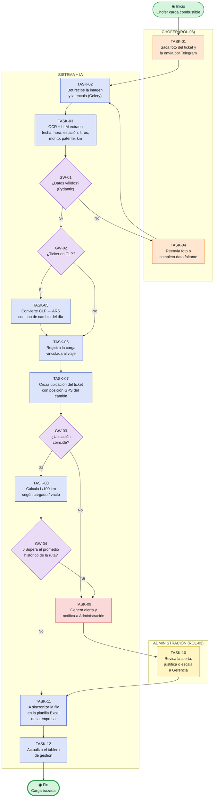
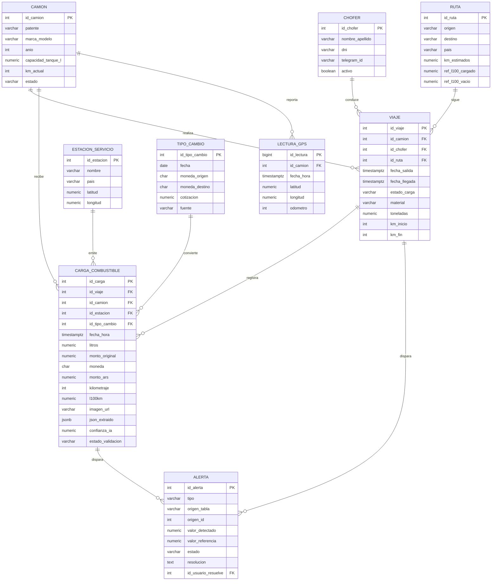
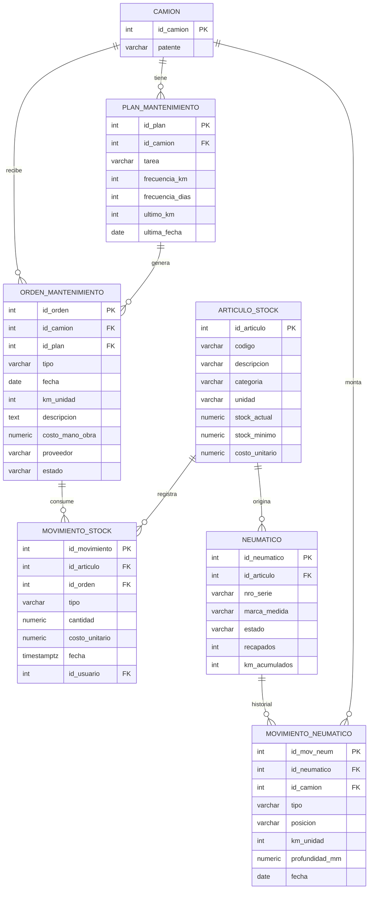
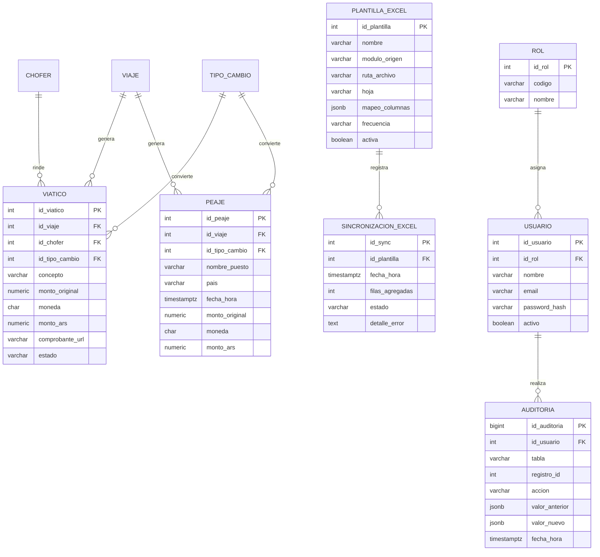
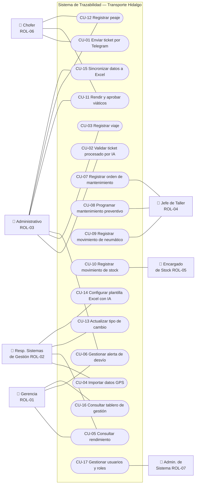
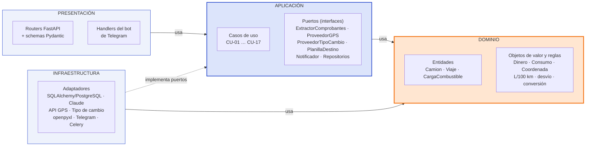
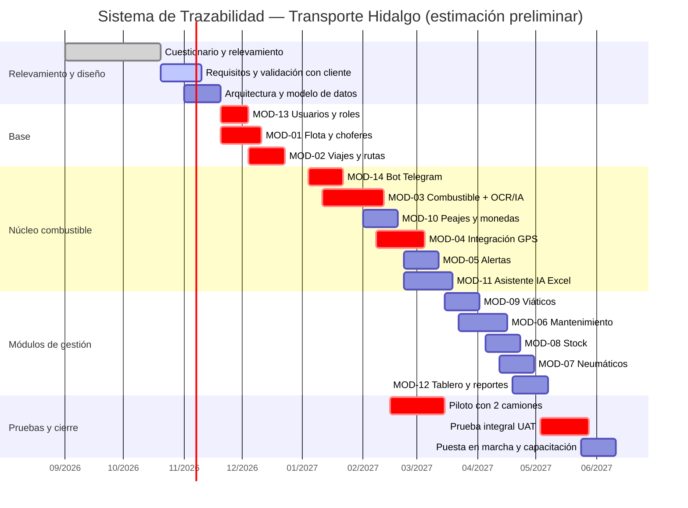

# Transporte Hidalgo — San Juan

## Sistema de Trazabilidad de Combustible y Gestión de Flota

### Documento de Requisitos Funcionales

| Campo | Detalle |
| --- | --- |
| Versión | 1.1 — Stack tecnológico y arquitectura limpia |
| Fecha | 23 de octubre de 2026 |
| Elaborado por | Mathias Giménez — Asesoramiento en automatización con IA |
| Revisado por | Gustavo Hidalgo (Gerente General) — Silvana Rodríguez (Resp. Sistemas de Gestión) |
| Estado | Borrador — Para revisión y aprobación del cliente |
| Repositorio | A definir |
| Sistema reemplazado | Planillas Excel / Google Sheets y registros en papel (tickets, comprobantes y partes) |

> **Cómo leer este documento:** cada requisito, rol, caso de uso y módulo tiene un código (RF-xx, ROL-xx, CU-xx, MOD-xx). Los casos de uso indican qué requisitos implementan y la sección 16 vincula cada hallazgo con sus requisitos, casos de uso y módulos. Los puntos marcados con ⚠️ están pendientes de confirmación (sección 17).

---

## Índice

1. [Introducción](#1-introducción)
2. [Bitácora de relevamiento](#2-bitácora-de-relevamiento)
3. [Descripción de la situación actual](#3-descripción-de-la-situación-actual)
4. [Problemas y hallazgos detectados](#4-problemas-y-hallazgos-detectados)
5. [Requisitos funcionales y no funcionales](#5-requisitos-funcionales-y-no-funcionales)
6. [Glosario](#6-glosario)
7. [Descripción de roles](#7-descripción-de-roles)
8. [Casos de uso](#8-casos-de-uso)
9. [Diagrama BPMN del proceso principal](#9-diagrama-bpmn-del-proceso-principal)
10. [Diagrama de entidades](#10-diagrama-de-entidades)
11. [Diagrama de casos de uso](#11-diagrama-de-casos-de-uso)
12. [Módulos del sistema](#12-módulos-del-sistema)
13. [Capa de backoffice](#13-capa-de-backoffice)
14. [Arquitectura técnica y stack tecnológico](#14-arquitectura-técnica-y-stack-tecnológico)
15. [Planificación y cronograma](#15-planificación-y-cronograma)
16. [Matriz de trazabilidad](#16-matriz-de-trazabilidad)
17. [Supuestos y puntos abiertos](#17-supuestos-y-puntos-abiertos)
18. [Control de cambios](#18-control-de-cambios)

---

## 1. Introducción

### 1.1 Propósito del documento

El presente documento formaliza los requisitos del **Sistema de Trazabilidad de Combustible y Gestión de Flota** de Transporte Hidalgo, empresa familiar de transporte de cal y otros materiales con base en Ruta 40, Albardón (San Juan), que opera viajes dentro de Argentina y hacia Chile.

El eje del sistema es la **trazabilidad del combustible**: saber, para cada litro cargado, qué camión lo consumió, en qué viaje, en qué ruta, si el camión iba cargado o vacío y si el consumo es normal. El combustible representa aproximadamente el **60 % del gasto total** de la empresa. Alrededor de ese eje se integran los módulos de mantenimiento, neumáticos, stock, viáticos y peajes (con conversión de moneda ARS ↔ CLP), además de un asistente de IA que vuelca los datos generados en la planilla Excel propia de la empresa.

El documento consolida la información obtenida en el cuestionario de diagnóstico, la reunión de relevamiento y el borrador inicial de requisitos de combustible. Tiene carácter de acuerdo base entre el equipo de desarrollo y la empresa, y debe ser revisado y aprobado por la Gerencia antes del inicio del desarrollo. Cualquier modificación posterior deberá registrarse en la sección 18. Control de cambios.

### 1.2 Alcance del sistema

El sistema cubrirá los siguientes procesos:

- Registro de flota (camiones), choferes, rutas y viajes, diferenciando tramos cargados y vacíos.
- Ingesta inteligente de tickets de combustible por foto (Telegram o panel) con extracción OCR + LLM.
- Cálculo automático de consumo (L/100 km) y costo por camión, chofer, ruta y viaje.
- Integración con la telemetría GPS existente y validación geográfica de cada carga.
- Sistema de alertas por desvíos de consumo y anomalías.
- Gestión de mantenimiento preventivo y correctivo de los camiones.
- Gestión de neumáticos: montaje, rotación, recapado, baja y costo por km.
- Gestión de stock de repuestos, lubricantes, neumáticos e insumos.
- Rendición y aprobación de viáticos de choferes.
- Registro de peajes en Argentina y Chile con conversión automática de moneda ARS ↔ CLP.
- Asistente de IA que carga los datos generados en la planilla Excel propia de la empresa.
- Tablero de gestión, reportes y gestión de usuarios y roles (backoffice).

**Fuera de alcance:**

- Facturación electrónica al cliente y liquidación de sueldos (identificados como prioridad en el diagnóstico; previstos para una fase posterior).
- Contabilidad general: el sistema contable actual se mantiene.
- Reemplazo de la plataforma de telemetría GPS: se integra, no se sustituye.
- Aplicación móvil nativa: el canal del chofer es Telegram.

### 1.3 Equipo del proyecto

| Rol | Persona | Responsabilidades |
| --- | --- | --- |
| Gerente General / Product Owner | Gustavo Hidalgo | Decisor final. Aprueba alcance, prioridades y entregables. |
| Referente funcional | Silvana Rodríguez | Resp. de Sistemas de Gestión. Valida requisitos, provee planillas y procedimientos, coordina pruebas. |
| Analista funcional y desarrollador | Mathias Giménez | Relevamiento, diseño, desarrollo full-stack (Python + FastAPI / React + TypeScript / PostgreSQL) con arquitectura limpia, integración de IA y puesta en marcha. |
| Administración | Equipo administrativo (4) | Usuarios principales: validación de tickets, viáticos, peajes y alertas. |
| Mantenimiento / Taller | Equipo de taller (5) | Usuarios de mantenimiento, neumáticos y stock. Validación funcional. |
| Choferes | Personal de conducción | Envían tickets y comprobantes por Telegram. Participan del piloto. |

### 1.4 Metodología de relevamiento

El relevamiento se realizó en dos etapas: (1) un cuestionario de diagnóstico empresarial respondido por la Responsable de Sistemas de Gestión, y (2) una reunión de relevamiento presencial con Gerencia y Sistemas de Gestión, guiada por una pauta de preguntas enfocada en facturación y combustible. A partir de ambas, se elaboró un borrador inicial de requisitos de combustible y se definió el alcance modular del sistema en una sesión de trabajo posterior.

### 1.5 Stack tecnológico y enfoque de arquitectura

El sistema se desarrolla con **Python** en el backend (FastAPI, Celery, Pydantic, SQLAlchemy), **React + TypeScript** en el panel web y **PostgreSQL** como base de datos, con un bot de **Telegram** como canal de los choferes y **Claude (Anthropic)** como modelo de IA con visión.

El backend se construye con **arquitectura limpia**, organizada por módulo: las reglas de negocio (consumo, conversión de moneda, alertas) quedan aisladas de la base de datos y de los servicios externos, que se conectan mediante puertos y adaptadores. El detalle completo está en la sección 14.

---

## 2. Bitácora de relevamiento

Esta sección registra cronológicamente cada instancia de relevamiento. Constituye la fuente primaria de la que se derivan los hallazgos y los requisitos del sistema.

### 2.1 Etapa 1 — Cuestionario de diagnóstico (septiembre 2026)

| Campo | Detalle |
| --- | --- |
| Fecha | Septiembre de 2026 |
| Participantes | Silvana Rodríguez (respondió) — Gustavo Hidalgo (decisor) |
| Objetivo | Conocer la empresa, su flujo de información, su madurez digital y sus principales dolores. |

**Observaciones:**

- Empresa familiar con 70 años en el mercado, 40 empleados: 4 en administración, 5 en mantenimiento y el resto choferes y operativos.
- Trabaja con un único cliente, con relación estable de años. La solicitud de carga del cliente llega por Telegram.
- No cuenta con ERP, CRM ni sistemas a medida. Usa un sistema contable, planillas Excel / Google Sheets y telemetría GPS en las unidades. No tiene área de IT.
- Madurez digital baja: sistemas 2/5, automatización 1/5, datos y reportes 1/5, comodidad con herramientas nuevas 1–2/5. Documentación de procesos 4/5.

**Hallazgos:**

- El combustible representa aproximadamente el 60 % del gasto total de la empresa.
- El 50 % de las horas administrativas semanales se dedica a tareas repetitivas (carga manual, reportes, seguimiento).
- La facturación tiene más de un mes de atraso por demora en la carga administrativa.
- La empresa expresa: "necesitamos un sistema integrado de gestión en tiempo real".
- La telemetría GPS ya genera datos que no se cruzan con los gastos reales.

**Próximos pasos:** Relevar en detalle los procesos de facturación y combustible.

---

### 2.2 Etapa 2 — Reunión de relevamiento (16 de octubre de 2026)

| Campo | Detalle |
| --- | --- |
| Fecha | 16 de octubre de 2026 |
| Participantes | Gustavo Hidalgo (Gerente General) — Silvana Rodríguez (Resp. Sistemas de Gestión) — Mathias Giménez |
| Objetivo | Mapear los procesos prioritarios, acordar por cuál comenzar y definir la métrica de éxito. |

**Observaciones:**

- ⚠️ A completar con las notas de la reunión: cómo se registran hoy las cargas, quién las autoriza, qué datos exporta el GPS y cómo se identifican los tramos cargados y vacíos.

**Hallazgos:**

- Se define la trazabilidad del combustible como eje del sistema, por su peso en el gasto total.
- Se identifica la necesidad de controlar además los gastos asociados a la flota y a los viajes: mantenimiento, neumáticos, stock, viáticos y peajes.
- Los viajes a Chile generan gastos en pesos chilenos (CLP) que hoy no tienen un criterio uniforme de conversión.

**Próximos pasos:** Formalizar un borrador de requisitos de combustible y definir el alcance modular completo.

---

### 2.3 Sesión de trabajo — Definición de alcance (23 de octubre de 2026)

| Campo | Detalle |
| --- | --- |
| Fecha | 23 de octubre de 2026 |
| Participantes | Mathias Giménez (análisis y diseño) |
| Objetivo | Consolidar el borrador de combustible y el alcance modular en un documento de requisitos con trazabilidad. |

**Observaciones:**

- Se integra el borrador inicial de requisitos: ingesta de tickets con OCR + LLM y validación Pydantic, cálculo de consumo L/100 km diferenciado cargado / vacío, alertas por desvío y validación geográfica contra GPS.
- Se definen los módulos: combustible (gastos y consumo), mantenimiento, neumáticos, stock, viáticos y peajes con conversión ARS ↔ CLP.
- Se define como requisito un asistente de IA que cargue los datos generados en la planilla Excel propia de la empresa.
- Stack tecnológico definido: Python con FastAPI, Celery para procesamiento asincrónico y PostgreSQL. Panel de administración web (backoffice) en React.
- Se define desarrollar el backend con arquitectura limpia, organizada por módulo, para aislar las reglas de negocio de las integraciones externas aún no definidas (GPS, LLM, tipo de cambio, ubicación de la planilla Excel).

**Hallazgos:**

- Mantener la planilla Excel como herramienta de trabajo de la empresa reduce la resistencia al cambio en un equipo con baja comodidad digital.
- Telegram, ya utilizado por la empresa, es el canal de menor fricción para que los choferes envíen tickets y comprobantes.

**Próximos pasos:** Validar este documento con Gerencia y Sistemas de Gestión. Obtener muestras reales de tickets (AR y CL), la planilla Excel actual y una exportación de la telemetría GPS.

---

## 3. Descripción de la situación actual

Transporte Hidalgo gestiona hoy su operación con planillas Excel / Google Sheets, un sistema contable y registros en papel. La flota cuenta con telemetría GPS, pero sus datos no se integran con los gastos. Esta sección describe la situación relevada; los puntos marcados con ⚠️ deben confirmarse con la empresa.

### 3.1 Workflow operativo actual

1. El cliente solicita la carga por **Telegram**.
2. Se asigna camión y chofer, y se realiza el viaje (dentro de Argentina o hacia Chile), en general cargado de ida y vacío de regreso. ⚠️
3. Durante el viaje el chofer carga combustible y paga peajes y gastos de viaje en ARS o CLP, obteniendo **tickets en papel**.
4. Los tickets se entregan en administración al regreso del viaje y se cargan manualmente en planillas Excel. ⚠️
5. La telemetría GPS registra el recorrido en la plataforma del proveedor, sin cruce con las cargas de combustible.
6. Los reportes de gasto se arman a mano, por área y por período.

### 3.2 Herramientas en uso

| Herramienta | Uso actual | Estado |
| --- | --- | --- |
| Planillas Excel / Google Sheets | Registro de viajes, gastos y control por área. | ✅ En uso — Crítico |
| Sistema contable | Registración contable de la empresa. | ✅ En uso (se mantiene) |
| Telemetría GPS | Seguimiento de unidades: posición, recorrido y kilometraje. | ⚠️ En uso — Subutilizado |
| Telegram | Recepción de pedidos de carga del cliente. | ✅ En uso |
| Papel | Tickets de combustible, peajes y comprobantes de viáticos. | ⚠️ En uso — Riesgo de pérdida |
| ERP / CRM / IT propio | No existen. | ❌ No disponible |

### 3.3 Situación relevada por módulo

| Área | Situación actual | Pendiente de confirmar |
| --- | --- | --- |
| Combustible | Tickets en papel cargados a mano en Excel. Sin cálculo sistemático de L/100 km ni cruce con GPS. | ⚠️ Confirmar medio de pago (tarjeta flota, cuenta corriente, efectivo). |
| Mantenimiento | Equipo propio de 5 personas en taller. | ⚠️ Confirmar cómo se registran órdenes y preventivos. |
| Neumáticos | Sin registro relevado. | ⚠️ Confirmar si existe numeración / control de recapados. |
| Stock | Sin registro relevado. | ⚠️ Confirmar si hay pañol y planilla de stock. |
| Viáticos | Comprobantes en papel, rendición manual. | ⚠️ Confirmar esquema (monto fijo por viaje o rendición de gastos). |
| Peajes | Pagos en ARS y CLP sin criterio uniforme de conversión. | ⚠️ Confirmar medio de pago en Chile (efectivo, TAG). |

---

## 4. Problemas y hallazgos detectados

| # | Problema detectado | Impacto | Mejora propuesta |
| --- | --- | --- | --- |
| H-01 | Los tickets de combustible son de papel y se cargan a mano, con demora o se pierden. | El 60 % del gasto no se controla en tiempo real. | Envío de foto por Telegram y extracción automática con IA. |
| H-02 | El 50 % de las horas administrativas se usa en tareas repetitivas. | Cuello de botella en un equipo de 4 personas; atrasos. | Automatizar la carga y validación de gastos. |
| H-03 | El GPS está instalado pero sus datos no se cruzan con las cargas. | No se detectan desvíos ni cargas fuera de ruta. | Integración GPS y validación geográfica de cada ticket. |
| H-04 | No hay referencia de consumo por ruta ni por estado de carga. | No se puede saber si un consumo es normal. | Promedio histórico por ruta y por tramo cargado / vacío. |
| H-05 | Los gastos en Chile se registran en CLP sin conversión estandarizada. | Totales inconsistentes y difíciles de comparar. | Tabla de tipo de cambio diaria y conversión automática. |
| H-06 | La información está dispersa en planillas por área. | Reportes manuales y sin visión integrada. | Base de datos única y tablero de gestión. |
| H-07 | La planilla Excel propia es la herramienta de trabajo de la empresa. | Eliminarla genera resistencia al cambio. | Asistente de IA que vuelca los datos en esa planilla. |
| H-08 | La comodidad del equipo con herramientas nuevas es baja (1–2/5). | Riesgo de no adopción del sistema. | Interfaz mínima, Telegram para choferes y capacitación. |
| H-09 | Mantenimiento, neumáticos y stock no tienen trazabilidad por camión. ⚠️ | Se desconoce el costo real por unidad. | Módulos integrados con historial y costo por camión. |
| H-10 | La empresa no tiene área de IT. | Dependencia y riesgo de pérdida de datos. | Backoffice a cargo del equipo de desarrollo y respaldos automáticos. |

---

## 5. Requisitos funcionales y no funcionales

> Prioridad: 🔴 Alta — imprescindible para la primera versión · 🟡 Media — deseable en la primera versión · 🟢 Baja — puede postergarse.

### 5.1 Ingesta y extracción inteligente de datos

*Módulo: MOD-03 · MOD-14*

| ID | Descripción | Prioridad |
| --- | --- | --- |
| RF-01 | El sistema debe recibir fotos de tickets de combustible enviadas por los choferes a través de un bot de Telegram vinculado a su usuario. | 🔴 Alta |
| RF-02 | El sistema debe permitir la carga manual de tickets (imagen o PDF) desde el panel de administración. | 🔴 Alta |
| RF-03 | El sistema debe extraer mediante OCR + LLM con visión, en formato JSON estructurado: fecha, hora, estación de servicio, litros, monto, moneda, patente y kilometraje. | 🔴 Alta |
| RF-04 | El backend debe validar con Pydantic los tipos y rangos de los datos extraídos antes de guardarlos (litros > 0 y ≤ capacidad del tanque, fecha no futura, patente existente en la flota). | 🔴 Alta |
| RF-05 | El procesamiento de imágenes debe ejecutarse en segundo plano (Celery) y el bot debe confirmar al chofer los datos leídos. | 🔴 Alta |
| RF-06 | Si la extracción falla o tiene baja confianza, la carga debe quedar en estado "Pendiente de validación" y el bot debe pedir al chofer reenviar la foto o completar el dato faltante. | 🔴 Alta |
| RF-07 | El sistema debe conservar la imagen original de cada ticket vinculada a su registro como respaldo auditable. | 🔴 Alta |
| RF-08 | El sistema debe detectar tickets duplicados (misma estación, fecha y hora, monto y patente). | 🟡 Media |

### 5.2 Viajes y cálculo de consumo

*Módulo: MOD-02 · MOD-03*

| ID | Descripción | Prioridad |
| --- | --- | --- |
| RF-09 | El sistema debe registrar viajes con camión, chofer, ruta, fechas, material transportado (cal u otro), toneladas, kilometraje inicial y final, y estado de carga (cargado / vacío) por tramo. | 🔴 Alta |
| RF-10 | El sistema debe calcular automáticamente el consumo promedio con la fórmula L/100 km = Litros ÷ Kilómetros × 100, tomando los kilómetros entre cargas consecutivas o los informados por el GPS. | 🔴 Alta |
| RF-11 | El sistema debe diferenciar el rendimiento según el camión viaje cargado con cal u otro material, o regrese vacío, y compararlo con la referencia de la ruta para cada estado. | 🔴 Alta |
| RF-12 | El sistema debe mostrar consumo y costo de combustible por camión, chofer, ruta, viaje y período. | 🔴 Alta |
| RF-13 | El sistema debe mantener el promedio histórico de consumo por ruta y estado de carga, actualizándolo con cada viaje cerrado. | 🟡 Media |

### 5.3 Integración con telemetría GPS

*Módulo: MOD-04*

| ID | Descripción | Prioridad |
| --- | --- | --- |
| RF-14 | El sistema debe importar posiciones y odómetro desde la plataforma de telemetría GPS, mediante API o archivo exportado (CSV / Excel) según lo que permita el proveedor. | 🔴 Alta |
| RF-15 | El sistema debe asociar las lecturas GPS a cada camión y viaje por patente y rango horario. | 🔴 Alta |

### 5.4 Sistema de alertas y detección de anomalías

*Módulo: MOD-05*

| ID | Descripción | Prioridad |
| --- | --- | --- |
| RF-16 | El sistema debe generar una alerta cuando el consumo de una carga o viaje supere el promedio histórico de la ruta en un porcentaje configurable (valor inicial sugerido: 15 %). | 🔴 Alta |
| RF-17 | El sistema debe cruzar la ubicación de la estación del ticket con la posición GPS del camión a la hora de la carga, y alertar si la distancia supera un radio configurable. | 🔴 Alta |
| RF-18 | El sistema debe alertar cuando los litros de una carga superen la capacidad del tanque del camión. | 🔴 Alta |
| RF-19 | El sistema debe notificar las alertas en el panel y por Telegram o correo a Administración y Gerencia. | 🟡 Media |
| RF-20 | El sistema debe registrar la resolución de cada alerta (justificada / desvío confirmado) con usuario, fecha y comentario. | 🔴 Alta |

### 5.5 Mantenimiento de camiones

*Módulo: MOD-06*

| ID | Descripción | Prioridad |
| --- | --- | --- |
| RF-21 | El sistema debe registrar órdenes de mantenimiento correctivo y preventivo por camión: fecha, kilometraje, tareas, repuestos, mano de obra, taller (propio o externo) y costo. | 🔴 Alta |
| RF-22 | El sistema debe permitir definir planes de mantenimiento preventivo por camión con frecuencia por kilómetros y/o días. | 🔴 Alta |
| RF-23 | El sistema debe avisar cuando un camión esté próximo a un mantenimiento preventivo, según el kilometraje (GPS) o la fecha. | 🔴 Alta |
| RF-24 | El sistema debe mostrar el historial y el costo acumulado de mantenimiento por camión. | 🟡 Media |
| RF-25 | Los repuestos utilizados en una orden deben descontarse automáticamente del stock. | 🟡 Media |

### 5.6 Neumáticos

*Módulo: MOD-07*

| ID | Descripción | Prioridad |
| --- | --- | --- |
| RF-26 | El sistema debe registrar cada neumático con número de serie, marca, medida, estado (nuevo, en uso, recapado, baja) y cantidad de recapados. | 🔴 Alta |
| RF-27 | El sistema debe registrar montaje, desmontaje y rotación de neumáticos indicando camión, posición (eje y lado) y kilometraje de la unidad. | 🔴 Alta |
| RF-28 | El sistema debe calcular los kilómetros recorridos y el costo por kilómetro de cada neumático. | 🟡 Media |
| RF-29 | El sistema debe registrar mediciones de profundidad de banda y alertar cuando sea inferior al mínimo configurado. | 🟡 Media |

### 5.7 Stock

*Módulo: MOD-08*

| ID | Descripción | Prioridad |
| --- | --- | --- |
| RF-30 | El sistema debe mantener un catálogo de artículos (repuestos, lubricantes, neumáticos, insumos) con código, categoría, unidad y costo unitario. | 🔴 Alta |
| RF-31 | El sistema debe registrar ingresos, egresos y ajustes de stock con usuario, fecha y destino (orden de mantenimiento o camión). | 🔴 Alta |
| RF-32 | El sistema debe alertar cuando un artículo baje del stock mínimo definido. | 🟡 Media |
| RF-33 | El sistema debe valorizar el stock y mostrar consumos por camión y período. | 🟡 Media |

### 5.8 Viáticos de choferes

*Módulo: MOD-09*

| ID | Descripción | Prioridad |
| --- | --- | --- |
| RF-34 | El sistema debe registrar viáticos por chofer y viaje: concepto (comida, alojamiento, otros), monto, moneda y comprobante. | 🔴 Alta |
| RF-35 | El chofer debe poder enviar comprobantes de viáticos por Telegram, con la misma extracción por IA que los tickets de combustible. | 🟡 Media |
| RF-36 | El sistema debe aplicar un flujo de aprobación de la rendición: Pendiente → Aprobado / Observado, a cargo de Administración. | 🔴 Alta |
| RF-37 | El sistema debe totalizar los viáticos por chofer, viaje y período, en ARS y en moneda original. | 🟡 Media |

### 5.9 Peajes y conversión de moneda (ARS ↔ CLP)

*Módulo: MOD-10*

| ID | Descripción | Prioridad |
| --- | --- | --- |
| RF-38 | El sistema debe registrar peajes por viaje: puesto, país, fecha y hora, monto y moneda (ARS o CLP). | 🔴 Alta |
| RF-39 | El sistema debe mantener una tabla de tipos de cambio ARS ↔ CLP diaria, con actualización automática desde una fuente externa y carga manual de respaldo. | 🔴 Alta |
| RF-40 | Todo importe en CLP (combustible, peajes, viáticos) debe convertirse a ARS con la cotización vigente a la fecha del gasto, guardando monto original, moneda, cotización aplicada y monto convertido. | 🔴 Alta |
| RF-41 | La cotización aplicada a un gasto no debe modificarse al actualizar cotizaciones posteriores, salvo corrección explícita registrada en auditoría. | 🔴 Alta |
| RF-42 | El sistema debe permitir mantener un catálogo de puestos de peaje por ruta con tarifa de referencia para detectar diferencias. | 🟢 Baja |

### 5.10 Asistente de IA — Integración con planilla Excel

*Módulo: MOD-11*

| ID | Descripción | Prioridad |
| --- | --- | --- |
| RF-43 | El sistema debe permitir subir la planilla Excel propia de la empresa como plantilla de destino. | 🔴 Alta |
| RF-44 | La IA debe analizar la estructura de la planilla (hojas, encabezados, formatos) y proponer el mapeo entre los campos del sistema y las columnas; el usuario lo confirma o corrige. | 🔴 Alta |
| RF-45 | El sistema debe agregar automáticamente a la planilla los registros nuevos y validados (cargas, viajes, peajes, viáticos, mantenimientos), respetando el formato y sin sobrescribir datos existentes. | 🔴 Alta |
| RF-46 | La sincronización debe ser configurable: al validar cada registro, diaria o manual. | 🟡 Media |
| RF-47 | El sistema debe registrar cada sincronización (fecha, filas agregadas, errores) y permitir reintentarla. | 🟡 Media |
| RF-48 | El usuario debe poder pedir en lenguaje natural la carga de datos a la planilla (ej.: "pasá a la planilla las cargas de combustible de octubre del camión AB123CD"). | 🟡 Media |
| RF-49 | El sistema debe guardar una copia de respaldo de la planilla antes de cada escritura. | 🔴 Alta |

### 5.11 Tablero de gestión y reportes

*Módulo: MOD-12*

| ID | Descripción | Prioridad |
| --- | --- | --- |
| RF-50 | El sistema debe ofrecer un tablero con: gasto de combustible del período, L/100 km por camión, alertas abiertas, mantenimientos próximos, stock crítico y gastos en Chile. | 🔴 Alta |
| RF-51 | El sistema debe exportar reportes a Excel y PDF. | 🟡 Media |
| RF-52 | Los reportes deben poder filtrarse por camión, chofer, ruta, país y período. | 🟡 Media |

### 5.12 Usuarios, seguridad y auditoría

*Módulo: MOD-13*

| ID | Descripción | Prioridad |
| --- | --- | --- |
| RF-53 | El sistema debe gestionar usuarios y roles con permisos por módulo. | 🔴 Alta |
| RF-54 | Cada chofer debe vincularse con su cuenta de Telegram; solo los choferes vinculados pueden enviar tickets y comprobantes. | 🔴 Alta |
| RF-55 | El sistema debe registrar en auditoría las altas, modificaciones y eliminaciones sobre registros de gastos: usuario, fecha y hora, valor anterior y valor nuevo. | 🔴 Alta |

### 5.13 Requisitos no funcionales

| ID | Descripción | Prioridad |
| --- | --- | --- |
| RNF-01 | Usabilidad: el chofer opera solo desde Telegram; ninguna acción del chofer debe requerir más de 3 pasos. | 🔴 Alta |
| RNF-02 | Rendimiento: un ticket debe procesarse y confirmarse al chofer en menos de 60 segundos. | 🟡 Media |
| RNF-03 | Seguridad: contraseñas cifradas (hash), conexión HTTPS y acceso restringido por rol. | 🔴 Alta |
| RNF-04 | Respaldo: copia de seguridad diaria automática de la base de datos y de las imágenes de comprobantes. | 🔴 Alta |
| RNF-05 | Accesibilidad: panel web utilizable desde PC y celular (diseño responsive). | 🟡 Media |
| RNF-06 | Calidad de IA: precisión de extracción ≥ 95 % en campos críticos (litros, monto, patente), medida durante el piloto. | 🔴 Alta |
| RNF-07 | Costos: el consumo de IA por comprobante debe monitorearse y mantenerse dentro de un límite mensual configurable. | 🟡 Media |
| RNF-08 | Localización: idioma español y formatos de fecha y moneda de Argentina y Chile. | 🟡 Media |
| RNF-09 | Mantenibilidad: el backend se desarrolla con arquitectura limpia. La capa de dominio no depende de frameworks, base de datos ni servicios externos, y sus reglas (consumo, conversión de moneda, alertas) se cubren con pruebas unitarias. | 🔴 Alta |
| RNF-10 | Portabilidad: el entorno completo (API, workers, PostgreSQL, Redis) debe levantarse con Docker Compose, tanto en desarrollo como en producción. | 🟡 Media |

---

## 6. Glosario

| Término | Definición |
| --- | --- |
| **L/100 km** | Litros consumidos cada 100 kilómetros. Indicador de rendimiento de combustible: Litros ÷ Km × 100. |
| **Ticket** | Comprobante emitido por la estación de servicio en cada carga de combustible. |
| **OCR** | Reconocimiento óptico de caracteres: lectura automática de texto en una imagen. |
| **LLM con visión** | Modelo de lenguaje de IA capaz de interpretar imágenes y devolver datos estructurados. |
| **JSON** | Formato estándar de intercambio de datos estructurados. |
| **Pydantic** | Librería de Python para validar tipos y reglas de los datos antes de guardarlos. |
| **FastAPI** | Framework de Python para construir el backend (API) del sistema. |
| **Celery** | Herramienta de procesamiento de tareas en segundo plano (por ejemplo, la lectura de imágenes). |
| **PostgreSQL** | Motor de base de datos relacional del sistema. |
| **Telemetría GPS** | Sistema instalado en los camiones que informa posición, recorrido y kilometraje. |
| **Tramo cargado / vacío** | Parte del viaje recorrida con carga (ida, en general) o sin carga (regreso). |
| **Tipo de cambio** | Cotización utilizada para convertir importes entre pesos chilenos (CLP) y pesos argentinos (ARS). |
| **ARS / CLP** | Códigos ISO del peso argentino y del peso chileno. |
| **Recapado** | Proceso de renovación de la banda de rodamiento de un neumático usado. |
| **Bot de Telegram** | Cuenta automatizada de Telegram que recibe fotos y mensajes de los choferes y responde. |
| **Plantilla Excel** | Planilla propia de la empresa en la que el asistente de IA vuelca los datos del sistema. |
| **Backoffice** | Tareas técnicas operadas por el Administrador de sistema (ROL-07): base de datos, integraciones, respaldos y usuarios. No visible para la operación diaria. |
| **Frontoffice** | Capa operativa que usan los usuarios de la empresa: panel web y bot de Telegram. |
| **Arquitectura limpia** | Forma de organizar el código en capas concéntricas (dominio, aplicación, infraestructura, presentación) donde las dependencias apuntan siempre hacia el dominio. |
| **Puerto** | Interfaz definida en la capa de aplicación que describe lo que el sistema necesita de un servicio externo (ej.: ProveedorGPS). |
| **Adaptador** | Implementación concreta de un puerto en la capa de infraestructura (ej.: cliente de la API del proveedor GPS). |
| **Repositorio** | Puerto para guardar y recuperar entidades; su adaptador usa SQLAlchemy sobre PostgreSQL. |
| **SQLAlchemy / Alembic** | ORM de Python para trabajar con la base de datos y herramienta de migraciones para versionar su estructura. |
| **Redis** | Base de datos en memoria usada como cola de tareas de Celery. |
| **Docker / Docker Compose** | Contenedores que empaquetan cada servicio del sistema para que se ejecute igual en cualquier equipo. |
| **WSL2** | Subsistema de Linux para Windows; permite desarrollar en Linux desde VS Code. |

---

## 7. Descripción de roles

| Rol | Código | Responsabilidades | Accesos principales |
| --- | --- | --- | --- |
| Gerencia | ROL-01 | Supervisión general. Consulta tableros y reportes. Recibe alertas escaladas y aprueba decisiones. | Tablero. Reportes. Alertas. Lectura de todos los módulos. |
| Resp. de Sistemas de Gestión | ROL-02 | Configura parámetros, rutas, referencias de consumo, tipo de cambio y plantillas Excel. Referente funcional. | Todos los módulos. Configuración. Asistente IA Excel. |
| Administrativo | ROL-03 | Valida tickets procesados por IA, registra viajes, aprueba viáticos, registra peajes y gestiona alertas. | Viajes. Combustible. Viáticos. Peajes. Alertas. Sincronización Excel. |
| Jefe de Taller / Mantenimiento | ROL-04 | Gestiona órdenes y planes de mantenimiento y el ciclo de vida de los neumáticos. | Mantenimiento. Neumáticos. Consulta de stock. |
| Encargado de Stock | ROL-05 | Registra ingresos, egresos y ajustes de artículos. Controla stock mínimo. | Stock. Consulta de mantenimiento. |
| Chofer | ROL-06 | Envía tickets de combustible, peajes y comprobantes de viáticos por Telegram. Sin acceso al panel. | Bot de Telegram (solo sus propios envíos). |
| Administrador de sistema | ROL-07 | Gestiona usuarios y roles. Opera el backoffice: base de datos, integraciones (GPS, Telegram, IA, tipo de cambio), respaldos. Rol del equipo de desarrollo. | Panel de administración. Base de datos. Logs. Integraciones. |

### 7.1 Gerencia (ROL-01)

Rol de Gustavo Hidalgo. Accede en modo lectura a todo el sistema y al tablero de gestión. Recibe las alertas que Administración escala por desvíos confirmados o montos relevantes, y es quien decide las acciones correctivas.

### 7.2 Responsable de Sistemas de Gestión (ROL-02)

Rol de Silvana Rodríguez. Configura el sistema para la operación: rutas y su consumo de referencia, umbrales de alertas, radio de validación geográfica, fuente del tipo de cambio y plantillas Excel con su mapeo. Es la referente funcional ante el equipo de desarrollo.

### 7.3 Administrativo (ROL-03)

Rol de mayor interacción diaria. Revisa las cargas que la IA dejó pendientes o con baja confianza, registra y cierra viajes, aprueba u observa rendiciones de viáticos, registra peajes no enviados por Telegram y resuelve alertas. Puede ejecutar la sincronización manual con la planilla Excel.

### 7.4 Jefe de Taller / Mantenimiento (ROL-04)

Registra órdenes de mantenimiento correctivo y preventivo, define los planes preventivos por camión y gestiona montaje, rotación, recapado y baja de neumáticos. Consulta el stock disponible.

### 7.5 Encargado de Stock (ROL-05)

Mantiene el catálogo de artículos y registra sus movimientos. Si la empresa no tiene un puesto específico, este rol puede asignarse al Jefe de Taller. ⚠️

### 7.6 Chofer (ROL-06)

No usa el panel web. Interactúa únicamente con el bot de Telegram vinculado a su usuario: envía fotos de tickets de combustible, peajes y viáticos, y confirma o corrige los datos que el bot le devuelve.

### 7.7 Administrador de sistema (ROL-07)

Rol exclusivo del equipo de desarrollo. Da de alta usuarios y vincula choferes con Telegram, mantiene la base de datos y los respaldos, configura las integraciones externas (GPS, LLM, tipo de cambio) y monitorea el costo de uso de IA. No se asigna a personal de la empresa.

---

## 8. Casos de uso

### 8.1 Tabla resumen

| ID | Nombre | Actor | Módulo |
| --- | --- | --- | --- |
| CU-01 | Enviar ticket de combustible por Telegram | Chofer (ROL-06) | Bot Telegram / Combustible |
| CU-02 | Validar ticket procesado por IA | Administrativo (ROL-03) | Combustible |
| CU-03 | Registrar viaje | Administrativo (ROL-03) | Viajes y rutas |
| CU-04 | Importar datos de GPS | Resp. Sistemas (ROL-02) / Sistema | Integración GPS |
| CU-05 | Consultar rendimiento de combustible | Gerencia (ROL-01) / Resp. Sistemas (ROL-02) | Combustible / Tablero |
| CU-06 | Gestionar alerta de desvío | Administrativo (ROL-03) / Gerencia (ROL-01) | Alertas |
| CU-07 | Registrar orden de mantenimiento | Jefe de Taller (ROL-04) | Mantenimiento |
| CU-08 | Programar mantenimiento preventivo | Jefe de Taller (ROL-04) | Mantenimiento |
| CU-09 | Registrar movimiento de neumático | Jefe de Taller (ROL-04) | Neumáticos |
| CU-10 | Registrar movimiento de stock | Encargado de Stock (ROL-05) | Stock |
| CU-11 | Rendir y aprobar viáticos | Chofer (ROL-06) / Administrativo (ROL-03) | Viáticos |
| CU-12 | Registrar peaje con conversión de moneda | Chofer (ROL-06) / Administrativo (ROL-03) | Peajes y monedas |
| CU-13 | Actualizar tipo de cambio ARS ↔ CLP | Resp. Sistemas (ROL-02) / Sistema | Peajes y monedas |
| CU-14 | Configurar plantilla Excel con IA | Resp. Sistemas (ROL-02) | Asistente IA Excel |
| CU-15 | Sincronizar datos a la planilla Excel | Sistema / Administrativo (ROL-03) | Asistente IA Excel |
| CU-16 | Consultar tablero de gestión | Gerencia (ROL-01) | Tablero y reportes |
| CU-17 | Gestionar usuarios y roles | Administrador de sistema (ROL-07) | Usuarios y roles |

### 8.2 Detalle de casos de uso

---

#### CU-01 — Enviar ticket de combustible por Telegram

| Campo | Detalle |
| --- | --- |
| **ID** | CU-01 |
| **Nombre** | Enviar ticket de combustible por Telegram |
| **Actor principal** | Chofer (ROL-06) |
| **Descripción** | El chofer fotografía el ticket de la carga de combustible y lo envía al bot de Telegram. El sistema extrae los datos con IA y le confirma lo leído. |
| **Problema que resuelve** | Los tickets en papel llegan tarde a administración o se pierden, y se cargan a mano. Este caso de uso registra la carga en el momento en que ocurre, sin tipeo. |
| **Precondiciones** | El chofer está dado de alta y vinculado a Telegram. El camión está asignado a un viaje activo. |
| **Flujo principal** | 1. El chofer envía la foto del ticket al bot. 2. El bot confirma la recepción. 3. El sistema encola la imagen (Celery). 4. La IA extrae fecha, hora, estación, litros, monto, moneda, patente y km. 5. Pydantic valida los datos. 6. El sistema registra la carga vinculada al viaje activo. 7. El bot responde con el resumen leído para que el chofer confirme. |
| **Flujo alternativo / error** | E1 - Imagen ilegible o dato faltante: el bot pide reenviar la foto o escribir el dato. E2 - Patente distinta a la del viaje: la carga queda "Pendiente de validación". E3 - Ticket duplicado: el sistema lo rechaza e informa al chofer. |
| **Postcondición** | Carga registrada con estado "Validada por IA" o "Pendiente de validación", con imagen original asociada. |
| **Requisitos que implementa** | RF-01, RF-03 a RF-08 |

---

#### CU-02 — Validar ticket procesado por IA

| Campo | Detalle |
| --- | --- |
| **ID** | CU-02 |
| **Nombre** | Validar ticket procesado por IA |
| **Actor principal** | Administrativo (ROL-03) |
| **Descripción** | El administrativo revisa las cargas que la IA dejó pendientes, compara los datos con la imagen y los confirma o corrige. |
| **Problema que resuelve** | Asegura la calidad de los datos sin volver a cargar todo a mano: solo se revisan las excepciones. |
| **Precondiciones** | Existen cargas en estado "Pendiente de validación". |
| **Flujo principal** | 1. Ingresar a Combustible → Pendientes. 2. Seleccionar una carga; el sistema muestra la imagen junto a los datos extraídos. 3. Confirmar o corregir los campos. 4. El sistema revalida y guarda; registra la corrección en auditoría. 5. Estado: "Validada". |
| **Flujo alternativo / error** | E1 - Ticket inválido o ajeno a la empresa: el administrativo lo anula indicando el motivo. |
| **Postcondición** | Carga validada e incluida en el cálculo de consumo y en la sincronización Excel. |
| **Requisitos que implementa** | RF-02, RF-04, RF-06, RF-55 |

---

#### CU-03 — Registrar viaje

| Campo | Detalle |
| --- | --- |
| **ID** | CU-03 |
| **Nombre** | Registrar viaje |
| **Actor principal** | Administrativo (ROL-03) |
| **Descripción** | Se registra el viaje con camión, chofer, ruta, material, toneladas y tramos cargado / vacío, y se cierra al finalizar. |
| **Problema que resuelve** | Sin viaje no se puede saber en qué contexto se consumió el combustible. El viaje es la unidad de trazabilidad. |
| **Precondiciones** | Camión, chofer y ruta dados de alta. |
| **Flujo principal** | 1. Ingresar a Viajes → Nuevo viaje. 2. Seleccionar camión, chofer y ruta. 3. Indicar material, toneladas y fecha de salida. 4. El sistema toma el km inicial del GPS (o se carga a mano). 5. Al regresar, cerrar el viaje: el sistema toma el km final y calcula el consumo por tramo. |
| **Flujo alternativo / error** | E1 - Camión con viaje abierto: el sistema impide abrir otro. E2 - Sin datos GPS: se permite carga manual de km, marcada como "manual". |
| **Postcondición** | Viaje registrado; al cierre, con consumo L/100 km por tramo y costo total. |
| **Requisitos que implementa** | RF-09 a RF-13 |

---

#### CU-04 — Importar datos de GPS

| Campo | Detalle |
| --- | --- |
| **ID** | CU-04 |
| **Nombre** | Importar datos de GPS |
| **Actor principal** | Resp. Sistemas (ROL-02) / Sistema (automático) |
| **Descripción** | El sistema importa posiciones y odómetro de la telemetría GPS, de forma automática por API o por archivo exportado. |
| **Problema que resuelve** | El GPS ya genera la información de kilómetros y ubicación pero no se utiliza. Este caso de uso la incorpora al cálculo y a la validación de cargas. |
| **Precondiciones** | Acceso a la API del proveedor GPS o archivo exportado disponible. ⚠️ |
| **Flujo principal** | 1. El sistema consulta la API en forma programada (o el usuario sube el archivo). 2. Identifica cada camión por patente. 3. Guarda las lecturas (fecha, hora, coordenadas, odómetro). 4. Las asocia al viaje correspondiente. 5. Informa la cantidad de lecturas importadas. |
| **Flujo alternativo / error** | E1 - Patente desconocida: se informa y se descartan esas lecturas. E2 - Falla de la API: se reintenta y se notifica al Administrador de sistema. |
| **Postcondición** | Lecturas GPS disponibles para cálculo de consumo y validación geográfica. |
| **Requisitos que implementa** | RF-14, RF-15 |

---

#### CU-05 — Consultar rendimiento de combustible

| Campo | Detalle |
| --- | --- |
| **ID** | CU-05 |
| **Nombre** | Consultar rendimiento de combustible |
| **Actor principal** | Gerencia (ROL-01) / Resp. Sistemas (ROL-02) |
| **Descripción** | El usuario consulta el consumo L/100 km y el costo por camión, chofer, ruta y período, diferenciando cargado y vacío. |
| **Problema que resuelve** | Hoy no existe una referencia para saber si un camión consume de más. Este caso de uso da esa visibilidad sobre el 60 % del gasto. |
| **Precondiciones** | Existen viajes cerrados con cargas validadas. |
| **Flujo principal** | 1. Ingresar a Combustible → Rendimiento. 2. Aplicar filtros. 3. El sistema muestra ranking por camión, evolución mensual y comparación contra la referencia de ruta. 4. Exportar a Excel o PDF si se requiere. |
| **Flujo alternativo / error** | E1 - Sin datos para el filtro: el sistema lo informa. |
| **Postcondición** | Información consultada; sin cambios en los datos. |
| **Requisitos que implementa** | RF-10 a RF-13, RF-51, RF-52 |

---

#### CU-06 — Gestionar alerta de desvío

| Campo | Detalle |
| --- | --- |
| **ID** | CU-06 |
| **Nombre** | Gestionar alerta de desvío |
| **Actor principal** | Administrativo (ROL-03) / Gerencia (ROL-01) |
| **Descripción** | Ante una alerta (consumo excesivo, ubicación no coincidente, litros mayores a la capacidad), el usuario la analiza y la resuelve. |
| **Problema que resuelve** | Los desvíos hoy pasan desapercibidos. Este caso de uso garantiza que cada anomalía tenga un responsable y una resolución registrada. |
| **Precondiciones** | Existe una alerta en estado "Abierta". |
| **Flujo principal** | 1. El sistema notifica la alerta. 2. El administrativo abre el detalle: carga, viaje, mapa de la posición GPS y valores de referencia. 3. Consulta al chofer si es necesario. 4. Marca "Justificada" con comentario o "Desvío confirmado". 5. Si se confirma, se escala a Gerencia. |
| **Flujo alternativo / error** | E1 - Falta información para resolver: queda "En análisis" con recordatorio. |
| **Postcondición** | Alerta cerrada con resolución, usuario y fecha. |
| **Requisitos que implementa** | RF-16 a RF-20 |

---

#### CU-07 — Registrar orden de mantenimiento

| Campo | Detalle |
| --- | --- |
| **ID** | CU-07 |
| **Nombre** | Registrar orden de mantenimiento |
| **Actor principal** | Jefe de Taller (ROL-04) |
| **Descripción** | Se registra un mantenimiento correctivo o preventivo realizado a un camión, con repuestos y costos. |
| **Problema que resuelve** | Permite conocer el costo real de mantenimiento por camión y su historial. |
| **Precondiciones** | Camión dado de alta. Artículos de stock cargados. |
| **Flujo principal** | 1. Ingresar a Mantenimiento → Nueva orden. 2. Seleccionar camión y tipo. 3. Cargar km, tareas, mano de obra y taller. 4. Agregar repuestos desde el stock. 5. Cerrar la orden: el sistema descuenta stock y, si es preventivo, reinicia el plan. |
| **Flujo alternativo / error** | E1 - Repuesto sin stock: el sistema avisa y permite registrarlo como compra externa. |
| **Postcondición** | Orden registrada; stock actualizado; historial del camión actualizado. |
| **Requisitos que implementa** | RF-21, RF-24, RF-25 |

---

#### CU-08 — Programar mantenimiento preventivo

| Campo | Detalle |
| --- | --- |
| **ID** | CU-08 |
| **Nombre** | Programar mantenimiento preventivo |
| **Actor principal** | Jefe de Taller (ROL-04) |
| **Descripción** | Se define un plan preventivo por camión con frecuencia en kilómetros y/o días. |
| **Problema que resuelve** | Evita que los preventivos dependan de la memoria del personal. |
| **Precondiciones** | Camión dado de alta con kilometraje actual. |
| **Flujo principal** | 1. Ingresar a Mantenimiento → Planes. 2. Seleccionar camión y tarea. 3. Definir frecuencia en km y/o días. 4. El sistema calcula el próximo vencimiento. 5. Avisa cuando se acerca, según el km del GPS o la fecha. |
| **Flujo alternativo / error** | E1 - Plan duplicado para la misma tarea: el sistema lo impide. |
| **Postcondición** | Plan activo con próximo vencimiento calculado. |
| **Requisitos que implementa** | RF-22, RF-23 |

---

#### CU-09 — Registrar movimiento de neumático

| Campo | Detalle |
| --- | --- |
| **ID** | CU-09 |
| **Nombre** | Registrar movimiento de neumático |
| **Actor principal** | Jefe de Taller (ROL-04) |
| **Descripción** | Se registra el montaje, desmontaje, rotación, recapado o baja de un neumático. |
| **Problema que resuelve** | Los neumáticos son un gasto alto y hoy no tienen trazabilidad por unidad ni por kilómetro. |
| **Precondiciones** | Neumático dado de alta con número de serie. |
| **Flujo principal** | 1. Ingresar a Neumáticos y buscar por número de serie. 2. Seleccionar el movimiento. 3. Indicar camión, posición y km de la unidad. 4. Opcional: profundidad de banda. 5. El sistema actualiza el estado y los km acumulados. |
| **Flujo alternativo / error** | E1 - Posición ocupada: el sistema pide desmontar primero el neumático actual. |
| **Postcondición** | Historial del neumático actualizado y costo por km recalculado. |
| **Requisitos que implementa** | RF-26 a RF-29 |

---

#### CU-10 — Registrar movimiento de stock

| Campo | Detalle |
| --- | --- |
| **ID** | CU-10 |
| **Nombre** | Registrar movimiento de stock |
| **Actor principal** | Encargado de Stock (ROL-05) |
| **Descripción** | Se registran ingresos (compras), egresos (consumos) y ajustes de inventario. |
| **Problema que resuelve** | Da control sobre repuestos e insumos y vincula su consumo con cada camión. |
| **Precondiciones** | Artículo dado de alta en el catálogo. |
| **Flujo principal** | 1. Ingresar a Stock → Movimientos. 2. Seleccionar tipo y artículo. 3. Indicar cantidad, costo y destino. 4. El sistema actualiza el stock y lo valoriza. 5. Si queda bajo el mínimo, genera aviso. |
| **Flujo alternativo / error** | E1 - Egreso mayor al disponible: el sistema lo bloquea. |
| **Postcondición** | Stock actualizado con registro del movimiento. |
| **Requisitos que implementa** | RF-30 a RF-33 |

---

#### CU-11 — Rendir y aprobar viáticos

| Campo | Detalle |
| --- | --- |
| **ID** | CU-11 |
| **Nombre** | Rendir y aprobar viáticos |
| **Actor principal** | Chofer (ROL-06) / Administrativo (ROL-03) |
| **Descripción** | El chofer envía comprobantes de gastos de viaje por Telegram y Administración aprueba la rendición. |
| **Problema que resuelve** | Elimina el papel y la carga manual de la rendición, con conversión automática si el gasto es en Chile. |
| **Precondiciones** | Viaje registrado. |
| **Flujo principal** | 1. El chofer envía la foto del comprobante con el concepto. 2. La IA extrae monto, moneda y fecha. 3. Si está en CLP, el sistema convierte a ARS. 4. El administrativo revisa la rendición del viaje. 5. Aprueba u observa con comentario. |
| **Flujo alternativo / error** | E1 - Comprobante ilegible: se pide reenvío. E2 - Rendición observada: se notifica al chofer el motivo. |
| **Postcondición** | Viáticos del viaje con estado "Aprobado" u "Observado". |
| **Requisitos que implementa** | RF-34 a RF-37, RF-40 |

---

#### CU-12 — Registrar peaje con conversión de moneda

| Campo | Detalle |
| --- | --- |
| **ID** | CU-12 |
| **Nombre** | Registrar peaje con conversión de moneda |
| **Actor principal** | Chofer (ROL-06) / Administrativo (ROL-03) |
| **Descripción** | Se registra un peaje del viaje en ARS o CLP; el sistema guarda el monto original y su equivalente en ARS. |
| **Problema que resuelve** | Los peajes en Chile se pagan en CLP y hoy no se convierten con un criterio uniforme. |
| **Precondiciones** | Viaje registrado. Tipo de cambio del día disponible. |
| **Flujo principal** | 1. El chofer envía el comprobante por Telegram (o el administrativo lo carga). 2. Se identifica puesto, país, monto y moneda. 3. Si es CLP, el sistema aplica la cotización de la fecha. 4. Guarda monto original, cotización y monto en ARS. |
| **Flujo alternativo / error** | E1 - Sin cotización del día: se usa la última disponible y se marca para revisión. |
| **Postcondición** | Peaje registrado y sumado al costo del viaje. |
| **Requisitos que implementa** | RF-38 a RF-42 |

---

#### CU-13 — Actualizar tipo de cambio ARS ↔ CLP

| Campo | Detalle |
| --- | --- |
| **ID** | CU-13 |
| **Nombre** | Actualizar tipo de cambio ARS ↔ CLP |
| **Actor principal** | Sistema (automático) / Resp. Sistemas (ROL-02) |
| **Descripción** | El sistema obtiene diariamente la cotización desde una fuente externa; el responsable puede cargarla o corregirla a mano. |
| **Problema que resuelve** | Garantiza que todos los gastos en Chile se conviertan con la misma regla y que la cotización usada quede registrada. |
| **Precondiciones** | Fuente de cotización configurada. ⚠️ |
| **Flujo principal** | 1. Tarea diaria consulta la fuente. 2. Guarda fecha, monedas, cotización y fuente. 3. Si falla, notifica al responsable. 4. El responsable puede cargar la cotización manualmente. |
| **Flujo alternativo / error** | E1 - Corrección de una cotización ya usada: requiere confirmación y queda en auditoría; los gastos ya convertidos no cambian salvo pedido explícito. |
| **Postcondición** | Cotización del día disponible para conversiones. |
| **Requisitos que implementa** | RF-39, RF-41 |

---

#### CU-14 — Configurar plantilla Excel con IA

| Campo | Detalle |
| --- | --- |
| **ID** | CU-14 |
| **Nombre** | Configurar plantilla Excel con IA |
| **Actor principal** | Resp. Sistemas (ROL-02) |
| **Descripción** | Se sube la planilla Excel de la empresa y la IA propone cómo mapear los datos del sistema a sus columnas. |
| **Problema que resuelve** | La empresa no quiere perder su planilla de trabajo. El sistema se adapta a ella en lugar de obligar a cambiarla. |
| **Precondiciones** | Planilla Excel de la empresa disponible. |
| **Flujo principal** | 1. Ingresar a Asistente IA → Plantillas. 2. Subir el archivo y elegir la hoja. 3. La IA lee encabezados y formatos y propone el mapeo campo → columna. 4. El usuario confirma o ajusta. 5. Elegir módulo origen y frecuencia de sincronización. 6. Guardar la plantilla. |
| **Flujo alternativo / error** | E1 - Columna sin correspondencia: queda vacía o se le asigna un valor fijo. E2 - Planilla con macros o protegida: el sistema avisa y pide una versión editable. |
| **Postcondición** | Plantilla activa con mapeo confirmado. |
| **Requisitos que implementa** | RF-43, RF-44, RF-46 |

---

#### CU-15 — Sincronizar datos a la planilla Excel

| Campo | Detalle |
| --- | --- |
| **ID** | CU-15 |
| **Nombre** | Sincronizar datos a la planilla Excel |
| **Actor principal** | Sistema (automático) / Administrativo (ROL-03) |
| **Descripción** | El sistema agrega a la planilla de la empresa los registros validados, según la frecuencia configurada o a pedido en lenguaje natural. |
| **Problema que resuelve** | Elimina el doble tipeo: los datos que entran por Telegram terminan en la planilla de la empresa sin intervención manual. |
| **Precondiciones** | Plantilla configurada (CU-14). Registros validados pendientes de sincronizar. |
| **Flujo principal** | 1. Se dispara la sincronización (automática, programada o por pedido: "pasá las cargas de octubre"). 2. El sistema guarda copia de respaldo de la planilla. 3. Agrega las filas nuevas respetando formato. 4. Marca los registros como sincronizados. 5. Registra el resultado. |
| **Flujo alternativo / error** | E1 - Archivo en uso o inaccesible: se reintenta y se notifica. E2 - Error de formato en una fila: se omite esa fila y se informa. |
| **Postcondición** | Planilla actualizada y registro de sincronización guardado. |
| **Requisitos que implementa** | RF-45, RF-47, RF-48, RF-49 |

---

#### CU-16 — Consultar tablero de gestión

| Campo | Detalle |
| --- | --- |
| **ID** | CU-16 |
| **Nombre** | Consultar tablero de gestión |
| **Actor principal** | Gerencia (ROL-01) |
| **Descripción** | La Gerencia consulta en una sola pantalla los indicadores principales de la flota. |
| **Problema que resuelve** | Responde al pedido de "gestión en tiempo real" sin armar reportes a mano. |
| **Precondiciones** | Usuario con acceso al tablero. |
| **Flujo principal** | 1. Ingresar al Tablero. 2. Ver gasto de combustible, L/100 km por camión, alertas abiertas, mantenimientos próximos, stock crítico y gastos en Chile. 3. Filtrar por período. 4. Hacer clic en un indicador para ver el detalle. |
| **Flujo alternativo / error** | — |
| **Postcondición** | Información consultada. |
| **Requisitos que implementa** | RF-50 a RF-52 |

---

#### CU-17 — Gestionar usuarios y roles

| Campo | Detalle |
| --- | --- |
| **ID** | CU-17 |
| **Nombre** | Gestionar usuarios y roles |
| **Actor principal** | Administrador de sistema (ROL-07) |
| **Descripción** | Alta, baja, modificación y habilitación de usuarios, asignación de roles y vinculación de choferes con Telegram. |
| **Problema que resuelve** | Asegura que cada persona acceda solo a lo que le corresponde y que solo choferes autorizados envíen comprobantes. |
| **Precondiciones** | Sesión iniciada con ROL-07. |
| **Flujo principal** | 1. Ingresar a Usuarios. 2. Crear o editar el usuario. 3. Asignar rol. 4. Si es chofer, generar el código de vinculación; el chofer lo envía al bot. 5. El sistema confirma la vinculación. |
| **Flujo alternativo / error** | E1 - Email o Telegram ya vinculados a otro usuario: el sistema lo impide. |
| **Postcondición** | Usuario activo con rol asignado. |
| **Requisitos que implementa** | RF-53, RF-54 |

---

## 9. Diagrama BPMN del proceso principal

Proceso futuro (con el sistema) de trazabilidad de una carga de combustible, desde que el chofer carga en la estación hasta que el dato queda en la planilla Excel y en el tablero.

> **Leyenda de colores:** 🟧 chofer · 🟦 sistema / IA · 🟨 Administración · 🟪 decisiones (gateways) · 🟥 alertas · 🟩 inicio y fin.



### 9.1 Códigos de elementos del diagrama

| Código | Elemento | Descripción / CU o RF relacionado |
| --- | --- | --- |
| EVT-01 | Evento de inicio | El chofer carga combustible en una estación de servicio. |
| TASK-01 | Enviar foto del ticket | El chofer envía la foto por Telegram. CU-01. |
| TASK-02 | Recibir y encolar | El bot recibe la imagen y la encola en Celery. CU-01. |
| TASK-03 | Extraer datos con IA | OCR + LLM devuelven JSON con los campos del ticket. RF-03. |
| GW-01 | ¿Datos válidos? | Validación Pydantic de tipos y rangos. RF-04. |
| TASK-04 | Reenviar / completar | El chofer reenvía la foto o escribe el dato faltante. RF-06. |
| GW-02 | ¿Ticket en CLP? | Determina si corresponde conversión de moneda. |
| TASK-05 | Convertir CLP → ARS | Aplica la cotización vigente a la fecha. CU-13 / RF-40. |
| TASK-06 | Registrar carga | Guarda la carga vinculada al viaje y al camión. CU-01. |
| TASK-07 | Cruzar con GPS | Compara ubicación de la estación con la posición GPS. RF-17. |
| GW-03 | ¿Ubicación coincide? | Distancia dentro del radio configurado. |
| TASK-08 | Calcular L/100 km | Consumo diferenciado cargado / vacío. RF-10 / RF-11. |
| GW-04 | ¿Supera promedio de ruta? | Compara contra el histórico de la ruta. RF-16. |
| TASK-09 | Generar alerta | Alerta y notificación a Administración. RF-19. |
| TASK-10 | Revisar alerta | Administración justifica o escala a Gerencia. CU-06. |
| TASK-11 | Sincronizar Excel | La IA agrega la fila en la planilla de la empresa. CU-15. |
| TASK-12 | Actualizar tablero | Los indicadores se recalculan. CU-16. |
| EVT-02 | Evento de fin | Carga de combustible trazada de punta a punta. |

---

## 10. Diagrama de entidades

El modelo de datos físico está diseñado para **PostgreSQL** y se presenta en tres grupos. Criterios generales:

- Todo gasto (combustible, peaje, viático) referencia a un `VIAJE`, lo que permite obtener el costo total por viaje, camión y ruta.
- Los gastos guardan `monto_original`, `moneda`, `id_tipo_cambio` y `monto_ars`: la cotización aplicada queda fija (RF-40, RF-41).
- `CARGA_COMBUSTIBLE` guarda la imagen original (`imagen_url`), el resultado crudo de la IA (`json_extraido`, tipo `jsonb`) y su nivel de confianza (RF-03, RF-07).
- `ALERTA` es una tabla única para todos los tipos de alerta, identificando el registro de origen con `origen_tabla` y `origen_id`.
- `AUDITORIA` registra los cambios sobre datos de gastos con valor anterior y nuevo en `jsonb` (RF-55). Todas las tablas principales incluyen `created_at` y `updated_at` (omitidos en el diagrama).

### 10.1 Núcleo: flota, viajes, combustible, GPS y alertas



### 10.2 Mantenimiento, neumáticos y stock



### 10.3 Viáticos, peajes, moneda, Excel y seguridad



---

## 11. Diagrama de casos de uso

Actores del sistema y casos de uso que ejecutan.



---

## 12. Módulos del sistema

Cada módulo agrupa un conjunto de funcionalidades relacionadas y corresponde a un área operativa de la empresa.

| Módulo | Código | Descripción | Roles con acceso |
| --- | --- | --- | --- |
| Flota y choferes | MOD-01 | Registro de camiones (patente, modelo, capacidad de tanque, km) y choferes (datos, vinculación Telegram). | ROL-01, ROL-02, ROL-03, ROL-07 |
| Viajes y rutas | MOD-02 | Rutas con país, km y consumo de referencia cargado / vacío. Registro y cierre de viajes. Unidad de trazabilidad del sistema. | ROL-01, ROL-02, ROL-03 |
| Combustible | MOD-03 | Cargas de combustible con extracción IA, validación, imagen respaldatoria, cálculo de L/100 km y costo. | ROL-01, ROL-02, ROL-03 |
| Integración GPS | MOD-04 | Importación de posiciones y odómetro desde la telemetría existente. | ROL-02, ROL-07 |
| Alertas | MOD-05 | Detección de desvíos de consumo, validación geográfica, capacidad de tanque, preventivos y stock mínimo. | ROL-01, ROL-02, ROL-03 |
| Mantenimiento | MOD-06 | Órdenes correctivas y preventivas, planes por km / días, historial y costo por camión. | ROL-01, ROL-02, ROL-04 |
| Neumáticos | MOD-07 | Ciclo de vida de cada neumático: montaje, rotación, recapado, baja, km y costo por km. | ROL-01, ROL-02, ROL-04 |
| Stock | MOD-08 | Catálogo de artículos, movimientos, stock mínimo y valorización. | ROL-01, ROL-02, ROL-04, ROL-05 |
| Viáticos | MOD-09 | Rendición de gastos de viaje de choferes con flujo de aprobación. | ROL-01, ROL-02, ROL-03, ROL-06 |
| Peajes y monedas | MOD-10 | Registro de peajes en ARS / CLP y tabla de tipo de cambio diaria con conversión automática. | ROL-01, ROL-02, ROL-03, ROL-06 |
| Asistente IA — Excel | MOD-11 | Plantillas Excel de la empresa, mapeo propuesto por IA, sincronización automática y por lenguaje natural. | ROL-02, ROL-03 |
| Tablero y reportes | MOD-12 | Indicadores de gestión y reportes exportables a Excel y PDF. | ROL-01, ROL-02, ROL-03 |
| Usuarios y roles | MOD-13 | Cuentas, roles, permisos, vinculación con Telegram y auditoría. | ROL-07 |
| Bot de Telegram | MOD-14 | Canal de entrada de choferes: tickets de combustible, peajes y viáticos; confirmaciones y avisos. | ROL-06 |

### 12.1 Descripción detallada de módulos clave

#### MOD-03 — Combustible

Es el módulo central del sistema. Cada carga queda vinculada a camión, chofer, viaje y estación, con la imagen original del ticket como respaldo.

Extracción: la imagen se procesa en segundo plano con OCR + LLM con visión, que devuelve un JSON con fecha, hora, estación, litros, monto, moneda, patente y kilometraje. Pydantic valida el resultado antes de guardarlo; si la confianza es baja, la carga pasa a revisión de Administración (CU-02).

Cálculo: el consumo se calcula como Litros ÷ Kilómetros × 100. Los kilómetros surgen de la diferencia de odómetro entre cargas consecutivas del mismo camión (método tanque lleno) o, si está disponible, del recorrido informado por el GPS. El resultado se compara con la referencia de la ruta según el tramo se haya recorrido cargado o vacío.

#### MOD-10 — Peajes y monedas

Centraliza la regla de conversión para todos los gastos en Chile (combustible, peajes, viáticos). La tabla TIPO_CAMBIO guarda una cotización por día, con su fuente.

Cada gasto guarda cuatro datos: monto original, moneda, cotización aplicada y monto en ARS. La cotización aplicada queda fija para ese gasto, de modo que los reportes históricos no cambian cuando se actualizan cotizaciones posteriores.

#### MOD-11 — Asistente IA — Excel

Permite que la empresa siga trabajando con su propia planilla. Al subirla, la IA interpreta la estructura (hojas, encabezados, formatos de fecha y moneda) y propone qué campo del sistema va en cada columna. El usuario confirma el mapeo una sola vez.

A partir de ahí, los registros validados se agregan como filas nuevas, sin tocar los datos existentes y con respaldo previo del archivo. El usuario también puede pedirle al asistente en lenguaje natural que vuelque un conjunto de datos (por camión, período o módulo).

⚠️ A definir: si la planilla vive en una PC de la empresa, en OneDrive / SharePoint o en Google Drive, lo que determina el mecanismo de escritura.

#### MOD-14 — Bot de Telegram

Es la interfaz del chofer: no requiere instalar nada nuevo ni aprender un sistema. El chofer envía la foto y recibe una respuesta con los datos leídos para confirmar.

Comandos previstos: enviar ticket de combustible, enviar peaje, enviar viático y consultar el estado de sus envíos. Solo responde a choferes vinculados (RF-54).

---

## 13. Capa de backoffice

El backoffice es el conjunto de tareas técnicas que opera el Administrador de sistema (ROL-07). No es visible para los usuarios de la empresa y no forma parte de la operación diaria. Dado que Transporte Hidalgo no cuenta con área de IT, esta capa queda a cargo del equipo de desarrollo.

### 13.1 Separación frontoffice / backoffice

| Capa | Quién accede | Qué hace |
| --- | --- | --- |
| Frontoffice | ROL-01 a ROL-06 | Operación diaria: panel web (viajes, combustible, mantenimiento, stock, viáticos, peajes, tablero) y bot de Telegram. |
| Backoffice | ROL-07 (equipo de desarrollo) | Usuarios y roles, base de datos, respaldos, integraciones (GPS, LLM, Telegram, tipo de cambio), monitoreo y costos de IA. |

### 13.2 Funciones del backoffice

#### Gestión de usuarios

- Alta, baja, modificación, habilitación y deshabilitación de cuentas.
- Vinculación y desvinculación de choferes con Telegram.

#### Asignación de roles

- Asignar, modificar y revocar roles según las funciones de cada usuario.
- Consultar qué usuarios tienen cada rol para control y auditoría.

#### Integraciones

- Configuración de credenciales del proveedor GPS, del LLM, del bot de Telegram y de la fuente de tipo de cambio.
- Monitoreo de errores y reintentos de cada integración.

#### Datos y respaldos

- Respaldo diario automático de la base de datos y de las imágenes.
- Restauración ante fallos y migraciones de versión.

#### Monitoreo de IA

- Control de precisión de extracción y del costo de IA por comprobante y por mes.
- Ajuste de las instrucciones de extracción ante nuevos formatos de ticket.

---

## 14. Arquitectura técnica y stack tecnológico

Esta sección define el stack tecnológico, el enfoque de arquitectura limpia y el entorno de desarrollo. Parte de la arquitectura sugerida en el borrador inicial (Python con FastAPI, Celery y base de datos relacional) y la completa con las herramientas necesarias para construir el sistema.

### 14.1 Stack tecnológico

| Capa | Herramienta | Uso en el sistema |
| --- | --- | --- |
| Backend | Python 3.12 · uv | Lenguaje del backend y gestor de entorno y dependencias. |
| Backend | FastAPI | API REST del sistema y webhook del bot de Telegram. |
| Backend | Pydantic v2 | Validación estricta de datos de entrada y de la salida de la IA (RF-04). |
| Backend | SQLAlchemy 2.0 · Alembic · psycopg 3 | Acceso a datos (ORM), migraciones versionadas y conector PostgreSQL. |
| Backend | Celery · Redis | Procesamiento asincrónico de imágenes y tareas programadas (tipo de cambio diario, importación GPS, sincronización Excel). |
| Backend | python-telegram-bot | Bot de los choferes (MOD-14). |
| Backend | SDK de Anthropic (Claude con visión) | Lectura de tickets y comprobantes, mapeo de planillas y pedidos en lenguaje natural. Reemplaza al OCR tradicional. |
| Backend | openpyxl | Escritura en la planilla Excel de la empresa (MOD-11). |
| Backend | httpx | Cliente HTTP para APIs externas (GPS, tipo de cambio). |
| Backend | pytest · Ruff | Pruebas automatizadas, linter y formateo de código. |
| Frontend | React · Vite · TypeScript | Panel de administración web. |
| Frontend | Mantine (o shadcn/ui) | Componentes de interfaz: tablas, formularios, modales. |
| Frontend | TanStack Query · React Router | Consumo de la API con caché y navegación entre módulos. |
| Frontend | Recharts · Leaflet | Gráficos del tablero y mapa de validación geográfica. |
| Datos | PostgreSQL 16 | Base de datos del sistema; JSONB para el resultado crudo de la IA. |
| Infraestructura | Docker · Docker Compose | Contenedores para API, workers, PostgreSQL y Redis (RNF-10). |
| Infraestructura | Servidor en la nube (VPS) con HTTPS ⚠️ | Hosting de producción, a definir. |
| Herramientas | Visual Studio Code · WSL2 · Git / GitHub | Editor, entorno Linux en Windows y control de versiones. |

### 14.2 Arquitectura limpia

El backend se organiza en cuatro capas concéntricas. Principios que se aplican en el proyecto:

- **Regla de dependencia:** el código depende siempre hacia adentro. El dominio no conoce FastAPI, PostgreSQL, Telegram ni Claude.
- **El dominio es Python puro:** entidades y objetos de valor con `dataclasses`, sin dependencias externas. Pydantic se usa en la capa de presentación y para validar la salida de la IA.
- **Un caso de uso del documento = un caso de uso en el código:** CU-01 se implementa como `RegistrarCargaPorTicket`, CU-12 como `RegistrarPeaje`, y así sucesivamente. La trazabilidad del documento se mantiene en el código.
- **Puertos y adaptadores:** todo servicio externo se accede mediante una interfaz (puerto) definida en la capa de aplicación; la implementación concreta (adaptador) vive en infraestructura y puede reemplazarse sin tocar las reglas de negocio.
- **Organización por módulo:** cada módulo del sistema (MOD-xx) tiene su carpeta con sus propias capas, en lugar de cuatro carpetas globales.



#### Responsabilidad de cada capa

| Capa | Contenido en este sistema | Depende de |
| --- | --- | --- |
| Dominio | Entidades (Camion, Viaje, CargaCombustible, Neumatico, Peaje), objetos de valor (Dinero, Consumo, Coordenada) y reglas puras: cálculo de L/100 km, umbral de desvío, distancia ticket–GPS, conversión con cotización fija. | Nada (Python estándar). |
| Aplicación | Casos de uso (CU-01 a CU-17), puertos (interfaces de repositorios y servicios externos) y DTOs de entrada y salida. | Dominio. |
| Infraestructura | Adaptadores: repositorios SQLAlchemy / PostgreSQL, extractor de tickets con Claude, cliente GPS, proveedor de tipo de cambio, planilla Excel (openpyxl), tareas Celery. | Aplicación y dominio. |
| Presentación | Routers de FastAPI con schemas Pydantic, handlers del bot de Telegram, configuración e inyección de dependencias. | Aplicación. |

#### Puertos y adaptadores

Cada integración externa pendiente de definición (⚠️) queda detrás de un puerto; cambiar de proveedor implica escribir un nuevo adaptador sin modificar dominio ni casos de uso.

| Puerto (aplicación) | Adaptador (infraestructura) | Resuelve la variable |
| --- | --- | --- |
| ExtractorComprobantes | ClaudeExtractorComprobantes | Proveedor de LLM (RF-03). |
| ProveedorGPS | ApiGPSProveedor / ArchivoGPSImportador | API o exportación del proveedor GPS ⚠️ (RF-14). |
| ProveedorTipoCambio | ApiTipoCambio / CargaManualTipoCambio | Fuente de cotización ARS ↔ CLP ⚠️ (RF-39). |
| PlanillaDestino | OpenpyxlPlanilla / OneDrive / Google Sheets | Ubicación de la planilla de la empresa ⚠️ (RF-45). |
| Notificador | TelegramNotificador / EmailNotificador | Canal de avisos de alertas (RF-19). |
| AlmacenArchivos | DiscoLocal / Almacenamiento en la nube | Guardado de imágenes de comprobantes (RF-07). |
| Repositorio&lt;Entidad&gt; | SQLAlchemy&lt;Entidad&gt;Repositorio | Persistencia en PostgreSQL. |

#### Criterio de aplicación por módulo

Para no sobrecargar un proyecto desarrollado por una sola persona, la arquitectura se aplica con distinta profundidad según la complejidad de cada módulo:

| Nivel | Módulos | Motivo |
| --- | --- | --- |
| Arquitectura completa | Combustible (MOD-03), Alertas (MOD-05), Peajes y monedas (MOD-10), Asistente IA — Excel (MOD-11), Integración GPS (MOD-04), Viajes (MOD-02) | Concentran las reglas de negocio y las integraciones externas. Requieren pruebas unitarias del dominio. |
| Arquitectura liviana | Flota y choferes (MOD-01), Mantenimiento (MOD-06), Neumáticos (MOD-07), Stock (MOD-08), Viáticos (MOD-09), Usuarios (MOD-13) | Mayormente altas, bajas y modificaciones: caso de uso fino y repositorio, sin capas adicionales. |
| Solo lectura | Tablero y reportes (MOD-12) | Consultas optimizadas directas a la base de datos, sin pasar por entidades de dominio. |

### 14.3 Estructura del proyecto

El repositorio se organiza por módulo y, dentro de cada módulo, por capa:

```text
transporte-hidalgo/
├── docker-compose.yml          # api, worker, postgres, redis
├── .env.example                # claves (Claude, Telegram, GPS) — .env no se versiona
├── docs/
│   └── requisitos_v1.1.md      # este documento
├── backend/
│   ├── pyproject.toml          # dependencias (uv)
│   ├── alembic/                # migraciones de base de datos
│   ├── src/
│   │   ├── shared/             # Dinero, Coordenada, auditoría, unidad de trabajo
│   │   ├── combustible/
│   │   │   ├── domain/         # CargaCombustible, calcular_consumo()
│   │   │   ├── application/    # RegistrarCargaPorTicket, ValidarTicket, puertos
│   │   │   ├── infrastructure/ # SQLAlchemyCargaRepositorio, ClaudeExtractor
│   │   │   └── presentation/   # router FastAPI, schemas Pydantic
│   │   ├── viajes/
│   │   ├── gps/
│   │   ├── alertas/
│   │   ├── peajes_monedas/
│   │   ├── asistente_excel/
│   │   ├── mantenimiento/  neumaticos/  stock/  viaticos/
│   │   ├── usuarios/
│   │   ├── telegram_bot/       # handlers que invocan casos de uso
│   │   ├── workers/            # tareas Celery
│   │   └── main.py             # FastAPI + inyección de dependencias
│   └── tests/
│       ├── unit/               # dominio y casos de uso (sin BD ni red)
│       └── integration/        # repositorios y adaptadores
└── frontend/
    ├── package.json
    └── src/
        ├── api/                # cliente de la API (TanStack Query)
        ├── features/           # combustible/, viajes/, stock/, tablero/ ...
        ├── components/         # componentes compartidos
        └── main.tsx
```

### 14.4 Flujo técnico de un ticket por capas

| Paso | Capa | Acción |
| --- | --- | --- |
| 1 | Presentación | El handler de Telegram recibe la foto y la entrega al caso de uso como DTO. |
| 2 | Aplicación | RegistrarCargaPorTicket encola el procesamiento (Celery) y, en el worker, invoca al puerto ExtractorComprobantes. |
| 3 | Infraestructura | ClaudeExtractorComprobantes envía la imagen a Claude y devuelve el JSON validado con Pydantic. |
| 4 | Dominio | Se crea la entidad CargaCombustible; si el monto está en CLP, Dinero se convierte con la cotización del día obtenida del puerto ProveedorTipoCambio. |
| 5 | Dominio | Se calcula el consumo L/100 km y se evalúan las reglas de desvío y de validación geográfica. |
| 6 | Infraestructura | El repositorio persiste la carga en PostgreSQL; el Notificador emite la alerta si corresponde; PlanillaDestino agrega la fila al Excel. |
| 7 | Presentación | El bot responde al chofer con el resumen de la carga. |

### 14.5 Entorno de desarrollo (Visual Studio Code)

- **Sistema:** en Windows, desarrollar dentro de **WSL2** (Ubuntu) con la extensión "WSL" de VS Code. Celery no tiene soporte oficial en Windows.
- **Servicios locales:** PostgreSQL y Redis se levantan con `docker compose up -d`; no se instalan en el equipo.
- **Backend:** `uv sync` instala dependencias; `uv run alembic upgrade head` aplica migraciones; `uv run fastapi dev src/main.py` levanta la API; `uv run celery -A src.workers worker` levanta el worker.
- **Frontend:** `npm install` y `npm run dev` (Vite).
- **Extensiones de VS Code:** Python, Pylance, Ruff, ESLint, Prettier, Docker, WSL, REST Client (o Thunder Client), GitLens y un visor de Markdown con soporte Mermaid para leer este documento.
- **Secretos:** API key de Claude, token del bot de Telegram y credenciales GPS en `.env` (nunca en el repositorio); `.env.example` documenta las variables necesarias.
- **Calidad:** Ruff y pytest se ejecutan antes de cada commit; las pruebas unitarias del dominio no requieren base de datos ni conexión a internet.

---

## 15. Planificación y cronograma

### 15.1 Datos generales

| Campo | Detalle |
| --- | --- |
| Duración estimada | 7 meses (noviembre 2026 — junio 2027). Estimación preliminar. |
| Modalidad | Proyecto piloto sin costo de desarrollo para la empresa. |
| Metodología | Iterativa, con entregas cada 2 semanas y validación con la empresa en cada entrega. |
| Estrategia de adopción | Arrancar con el núcleo de combustible en 2 camiones piloto y sumar módulos de a uno. |
| Herramienta de gestión | GitHub Projects (a definir). |
| Entorno de desarrollo | Visual Studio Code + WSL2 + Docker Compose (ver sección 14.5). |

### 15.2 Orden de desarrollo por módulo

| Prioridad | Módulo | Código | Justificación |
| --- | --- | --- | --- |
| 1 | Usuarios y roles | MOD-13 | Base de todo el sistema: sin usuarios ni roles no opera ningún módulo. |
| 2 | Flota y choferes | MOD-01 | Entidades raíz: camiones y choferes. |
| 3 | Viajes y rutas | MOD-02 | Unidad de trazabilidad: todo gasto se asocia a un viaje. |
| 4 | Bot de Telegram | MOD-14 | Canal de entrada de los tickets. |
| 5 | Combustible | MOD-03 | Núcleo del sistema: 60 % del gasto. Habilita el piloto. |
| 6 | Peajes y monedas | MOD-10 | Necesario para cargas en Chile; reutilizado por viáticos. |
| 7 | Integración GPS | MOD-04 | Kilometraje real y validación geográfica. |
| 8 | Alertas | MOD-05 | Depende de combustible y GPS. |
| 9 | Asistente IA — Excel | MOD-11 | Vuelca a la planilla los datos ya validados. |
| 10 | Viáticos | MOD-09 | Reutiliza el canal Telegram y la extracción IA. |
| 11 | Mantenimiento | MOD-06 | Depende de flota y del km del GPS. |
| 12 | Stock | MOD-08 | Integrado con mantenimiento. |
| 13 | Neumáticos | MOD-07 | Depende de stock y flota. |
| 14 | Tablero y reportes | MOD-12 | Consolida la información de todos los módulos. |

### 15.3 Cronograma — Diagrama de Gantt

> Estimación preliminar, a ajustar tras la aprobación del alcance. Las tareas `crit` indican el camino crítico.



### 15.4 Hitos clave

| Mes | Hito | Entregable |
| --- | --- | --- |
| Oct 2026 | Relevamiento y requisitos | Documento de requisitos v1.1 para revisión. |
| Nov 2026 | Aprobación del alcance | Requisitos aprobados por Gerencia. Arquitectura y modelo de datos. |
| Dic 2026 | Base del sistema | Usuarios, flota, choferes y viajes operativos. |
| Feb 2027 | Núcleo de combustible | Bot de Telegram + extracción IA + cálculo de consumo. Inicio del piloto con 2 camiones. |
| Mar 2027 | Control y Excel | GPS, alertas, peajes con conversión y sincronización con la planilla Excel. |
| Abr 2027 | Módulos de gestión | Viáticos, mantenimiento, stock y neumáticos. |
| May 2027 | Tablero y UAT | Tablero de gestión. Prueba integral con usuarios de la empresa. |
| Jun 2027 | Puesta en marcha | Despliegue en toda la flota y capacitación. |

---

## 16. Matriz de trazabilidad

Vincula cada hallazgo del relevamiento (sección 4) con los requisitos que lo resuelven, los casos de uso que los implementan y los módulos donde se construyen.

| Hallazgo | Requisitos | Casos de uso | Módulos |
| --- | --- | --- | --- |
| H-01 Tickets en papel cargados a mano | RF-01 a RF-08 | CU-01, CU-02 | MOD-03, MOD-14 |
| H-02 50 % de horas administrativas repetitivas | RF-05, RF-45, RF-48 | CU-01, CU-15 | MOD-03, MOD-11 |
| H-03 GPS sin cruce con cargas | RF-14, RF-15, RF-17 | CU-04, CU-06 | MOD-04, MOD-05 |
| H-04 Sin referencia de consumo por ruta | RF-09 a RF-13, RF-16 | CU-03, CU-05, CU-06 | MOD-02, MOD-03, MOD-05 |
| H-05 Gastos en CLP sin conversión uniforme | RF-38 a RF-42 | CU-12, CU-13 | MOD-10 |
| H-06 Información dispersa | RF-50 a RF-52 | CU-16 | MOD-12 |
| H-07 Planilla Excel propia como herramienta | RF-43 a RF-49 | CU-14, CU-15 | MOD-11 |
| H-08 Baja comodidad digital | RF-01, RF-35, RNF-01, RNF-05 | CU-01, CU-11 | MOD-14 |
| H-09 Flota sin trazabilidad de costos | RF-21 a RF-37 | CU-07 a CU-11 | MOD-06 a MOD-09 |
| H-10 Sin área de IT | RF-53 a RF-55, RNF-03, RNF-04, RNF-09, RNF-10 | CU-17 | MOD-13, Backoffice |

---

## 17. Supuestos y puntos abiertos

Puntos a confirmar con la empresa antes de cerrar el diseño. Su respuesta puede modificar requisitos, casos de uso o el cronograma.

| # | Punto a confirmar | Por qué importa |
| --- | --- | --- |
| 1 | Cantidad de camiones de la flota y cuántos tienen GPS. | Dimensiona datos, costos de IA y el piloto. |
| 2 | Proveedor de telemetría GPS y si ofrece API o solo exportación. | Define MOD-04 y la validación geográfica. |
| 3 | Cómo se paga el combustible (tarjeta flota, cuenta corriente, efectivo) y si existe resumen digital del proveedor. | Un resumen digital podría complementar o validar los tickets. |
| 4 | Cómo se identifica hoy si un tramo es cargado o vacío. | Necesario para RF-11. |
| 5 | Dónde vive la planilla Excel de la empresa (PC, OneDrive, Google Drive) y su estructura actual. | Define el mecanismo de escritura de MOD-11. |
| 6 | Fuente oficial de tipo de cambio ARS ↔ CLP que la empresa acepta. | Necesario para RF-39. |
| 7 | Esquema de viáticos: monto fijo por viaje o rendición de gastos reales. | Define el flujo de MOD-09. |
| 8 | Si existe pañol / encargado de stock o lo gestiona el taller. | Define ROL-05. |
| 9 | Si los choferes tienen celular con Telegram y datos móviles en Chile. | Condición para el canal de ingesta; si no, se envía al recuperar señal. |
| 10 | Presupuesto mensual de IA aceptado por la empresa (proveedor propuesto: Claude de Anthropic). | Define costos operativos (RNF-07). |

---

## 18. Control de cambios

| Versión | Fecha | Descripción del cambio |
| --- | --- | --- |
| 0.1 | Oct 2026 | Borrador inicial de requisitos del sistema de combustible: ingesta OCR + LLM con Pydantic, cálculo L/100 km cargado / vacío, alertas por desvío, validación geográfica GPS y arquitectura sugerida (FastAPI, Celery, PostgreSQL / SQL Server). |
| 1.0 | 23 Oct 2026 | Documento consolidado con el formato estándar de requisitos. Incorporación de bitácora, situación actual, hallazgos, 55 RF y 8 RNF con prioridad, roles ROL-01 a ROL-07, casos de uso CU-01 a CU-17, módulos MOD-01 a MOD-14, diagramas BPMN, de entidades y de casos de uso, planificación y matriz de trazabilidad. Se fija PostgreSQL como base de datos. Se suman los módulos de mantenimiento, neumáticos, stock, viáticos, peajes con conversión ARS ↔ CLP y el asistente IA para planilla Excel. |
| 1.1 | 23 Oct 2026 | Incorporación del stack tecnológico completo (sección 1.5 y 14.1) y de la arquitectura limpia como enfoque de desarrollo: capas, puertos y adaptadores, criterio de aplicación por módulo, estructura del proyecto, flujo técnico por capas y entorno de desarrollo en VS Code (secciones 14.2 a 14.5). Nuevos RNF-09 (mantenibilidad) y RNF-10 (portabilidad). Glosario ampliado. Frontend confirmado en React + TypeScript. Versión Markdown del documento para el repositorio. |

---
